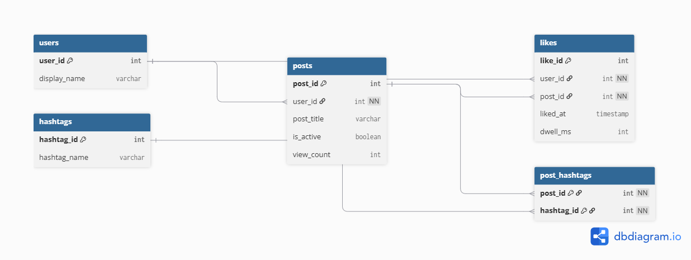

# Social Media Reaction Analytics | EX603 Portfolio

**Author:** Sahid Bangura · **Course:** Boston University EX603, Data and Algorithms for Scalable Systems

A PostgreSQL analytics portfolio investigating user reactions, creator engagement, spam-removal quality, inactive posts, and how these patterns change over time.

## Domain and business questions

Social media platforms need to understand who is engaging, how deeply users interact with content, and whether moderation signals reveal a problem. This portfolio examines reaction-level events, post-level activity, user participation, hashtags, geographic context, and the time pattern of engagement. The core questions are: Which posts have the most reactions? Which posts have unusually high spam-removal rates? Which posts have no recorded reactions? How do individual reaction dwell times compare with each post's average?

Those questions lead to decisions for two different teams. Trust and Safety can investigate spam-removal exceptions and verify moderation definitions. Creator Operations can look at posts with zero events to assess visibility, discoverability, onboarding, or data-pipeline gaps. Neither team should treat a missing event record as proof of creator behavior.

## Database overview

Two distinct contexts appear in this repository. **Units 1–2** include my own instructional social-media schema and ERD. **Units 3–6** use the separate **instructor-provided** 2023 dataset loaded into the PostgreSQL database `ex603_data`. The latter has six relevant public tables: `users`, `posts`, `likes`, `hashtags`, `post_hashtags`, and `post_media`. It is **not** generated by running my Unit 2 `schema/schema.sql`; do not run that DDL against `ex603_data`.

The Unit 2 design and integrity decisions are in [schema/schema.sql](schema/schema.sql) and [schema/constraints.md](schema/constraints.md). For the provided analytics dataset, `likes` is the reaction/event table, `users` identifies actors, `posts` identifies producers, and `post_hashtags` connects posts and catalog labels.

## Query catalogue

| Unit | SQL | Business question |
|---|---|---|
| 4 | [q4_1.sql](queries/unit4/q4_1.sql) | What are reaction totals, dwell-time statistics, creator activity, and regional patterns? |
| 4 | [q4_2.sql](queries/unit4/q4_2.sql) | What proportion of events are spam removals and what is the weighted high-volume baseline? |
| 5 | [q5_1.sql](queries/unit5/q5_1.sql) | Who reacted to each post, which tags do suspect posts share, and how do comparable posts differ? |
| 5 | [q5_2.sql](queries/unit5/q5_2.sql) | Which posts disappear under INNER JOIN, and do outer joins and anti-joins agree? |
| 5 | [q5_3.sql](queries/unit5/q5_3.sql) | How large is the Cartesian product and how does PostgreSQL execute the three-table join? |
| 6 | [q6_1.sql](queries/unit6/q6_1.sql) | Which reactions differ from their producer's average, and how do ranks and quartiles treat ties? |
| 6 | [q6_2.sql](queries/unit6/q6_2.sql) | How do events change sequentially, accumulate, smooth, and reveal gaps? |
| 6 | [q6_3.sql](queries/unit6/q6_3.sql) | What are the top three reactions per producer and monthly spam-removal trends? |

Interpretations: [Unit 4 analysis](analysis/unit4.md) · [Unit 5 analysis](analysis/unit5.md) · [Unit 6 analysis](analysis/unit6.md). Leadership memos: [Unit 4](analysis/unit4-finding.md), [Unit 5](analysis/unit5-finding.md), [Unit 6](analysis/unit6-finding.md).

## Technical highlights

1. **Conditional aggregation and CTEs:** Define spam failures consistently while preserving all event rows in the denominator.
2. **Outer joins, NOT EXISTS and EXCEPT:** Surface posts with no reactions that an ordinary INNER JOIN would hide; verify both directions of join equivalence.
3. **EXPLAIN and optimization:** Read a plan combining a hash join, nested loop, index scan, memoization and sort, rather than assuming a single technique.
4. **Window functions:** Keep original events while computing producer averages, ranks, prior/next measurements, running totals and top-N lists.
5. **Calendar-aware reporting:** Fill missing months and guard percent-change denominators against zero, so month-over-month comparisons are not silently misaligned.

## Findings and recommendations

- **Historical sample quality:** Of 200 reactions, 12 were removed specifically for spam (6.00%). Posts 2 and 3 had elevated rates of 3/16 (18.75%) and 2/13 (15.38%). Review moderation details and denominators rather than treating these small samples as proof of wrongdoing.
- **Engagement completeness:** Posts 14 and 15 recorded zero reactions. Use an all-post LEFT JOIN report to keep such producers visible, then investigate exposure, visibility and instrumentation before drawing conclusions.
- **Temporal trend:** The executed monthly query found all 12 months of 2023, no missing months, and fluctuating rates. January had 2/21 spam removals (9.52%) versus December 2/16 (12.50%); Q1 overall was 4/53 (7.55%) versus Q4 2/48 (4.17%). This is not clear evidence of sustained improvement.

## Limitations and future improvements

This is a historical educational dataset, not current platform telemetry. Small per-post counts, missing reaction dates, changing moderation definitions and the absence of exposure denominators limit causal and operational conclusions. Future work should validate the ingestion pipeline, add views/impressions, run longitudinal cohort analyses, and compare periods on consistent definitions. Core Unit 6 queries have been executed in pgAdmin and their visible results incorporated into the analysis. Supplemental audit queries and full screenshot evidence still need final verification/upload.

## Video presentation

**Pending:** Add the public or shareable 3–5 minute narrated screen-share video link here before final submission. The recording should demonstrate two or three queries, including a Unit 6 window function, and explain the findings and limitations.

## How to run

1. Install PostgreSQL and connect with pgAdmin or `psql`.
2. Create a separate database named `ex603_data` and load the **instructor-provided Unit 3 `social.sql`** file into it. That instructor dataset is not bundled in this repository. **Do not execute `schema/schema.sql` to recreate the analytics dataset:** it is the separate Unit 2 design.
3. Open each `.sql` file in `queries/unit4/`, `queries/unit5/`, or `queries/unit6/` using pgAdmin Query Tool on `ex603_data`. Execute individual statements to inspect their result sets, or run a script in `psql` after selecting the correct database.
4. Capture an original screenshot with the full executed SQL and output visible together; upload to `screenshots/` and link it to the matching task. See the [Unit 5 evidence checklist](screenshots/unit5/README.md).

## Repository and evidence integrity

No database passwords, credentials, connection strings, or private data should be committed. Screenshots should not contain personal data. Query outputs and trends must be checked against the real PostgreSQL database rather than assumed from SQL text.
