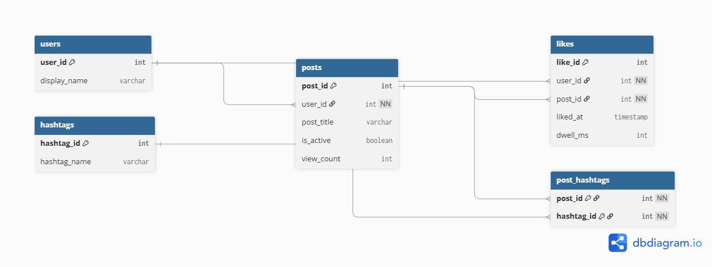

# EX 603 Social Media Database

**Student:** Sahid Bangura  
**Course:** EX 603  
**Theme:** Social Media

A relational database design for a social media platform that manages users, posts, likes, hashtags, and post-to-hashtag relationships.

## Domain

This project models a simplified social media platform. Users create posts, and each post belongs to exactly one user. Posts include an active/inactive state and a view count so the platform can distinguish current content and answer questions about content popularity. Users can also like posts. Each like records the user, the post, the time of the interaction, and a dwell-time metric that can support engagement analysis.

Hashtags classify posts. Because a post can have many hashtags and a hashtag can classify many posts, the design uses the `post_hashtags` junction relation to represent the many-to-many relationship. The model must answer questions such as: Which user created a post? Which posts receive the most views or likes? Which users liked a particular post? How long did users engage with content? Which hashtags are associated with a post, and which posts use a particular hashtag?

The design also prevents invalid states such as orphaned posts or likes, negative view counts or dwell times, duplicate post-hashtag associations, and references to users, posts, or hashtags that do not exist.

## Entity Relationship Diagram

## Schema

The implemented PostgreSQL schema contains five tables:

- `users` — platform users
- `posts` — posts created by users
- `likes` — user interactions with posts
- `hashtags` — reusable hashtag definitions
- `post_hashtags` — junction table connecting posts and hashtags

The schema enforces referential integrity with foreign keys and `ON DELETE CASCADE` where child records should not survive their parent records.

Non-negative `view_count` and `dwell_ms` values are enforced with CHECK constraints. The `post_hashtags` junction table uses a composite primary key to prevent duplicate post-hashtag relationships.

## Project Files

- `schema/erd.png` — exported ERD image
- `schema/erd.dbml` — editable dbdiagram.io source
- `schema/schema-definition.md` — relation schemas, attributes, domains, and primary keys
- `schema/constraints.md` — integrity constraints and ON DELETE decisions
- `schema/schema.sql` — complete PostgreSQL DDL for Assignment 2
- `analysis/unit1.md` — Unit 1 analysis
- `analysis/unit2.md` — Assignment 2 constraint reasoning and CHECK narrative
- `queries/` — reserved for later units
- `screenshots/` — assignment execution evidence

## Unit 4 — From Rows to Insight

**Dataset:** Instructor-provided 2023 Social Media reactions imported into separate PostgreSQL database `ex603_data` (200 reactions).

### Query catalogue

| File | Business questions |
|---|---|
| `queries/unit4/q4_1.sql` | Platform-wide dwell-time summary and unique reacting users; per-post volume and mean dwell; HAVING volume screen; performance by post and client country. |
| `queries/unit4/q4_2.sql` | Total vs. spam-removed reactions per post; ROLLUP regional subtotals and platform grand total; high-volume baseline computed via CTEs. |
| `analysis/unit4.md` | Methodology, interpretations, limitations, and 150–250-word reflection. |
| `analysis/unit4-finding.md` | Leadership summary, verified failure rate, and producer IDs for investigation. |
| `screenshots/` | PgAdmin query and result evidence (seven Unit 4 captures to be added). |

**Failure definition:** `reaction_status = 'removed'` AND `removal_reason = 'Spam detected'`. Of 200 reactions, 12 are spam removals (6.00%). The high-volume baseline is 11/194 (5.67%). The data is historical educational sample data, not a current-quarter payout report.

### Run locally

Create `ex603_data`, load the instructor-provided `social.sql` using the pgAdmin Query Tool connected to that database, then execute the queries in `queries/unit4/`. **Do not load this DROP/CREATE script into the separate Unit 2 database.**

**Evidence limitation:** Some original pgAdmin screenshots show only the end of the statement, so retake the captures with the full SQL and output legible in the same uncropped image before final submission.
